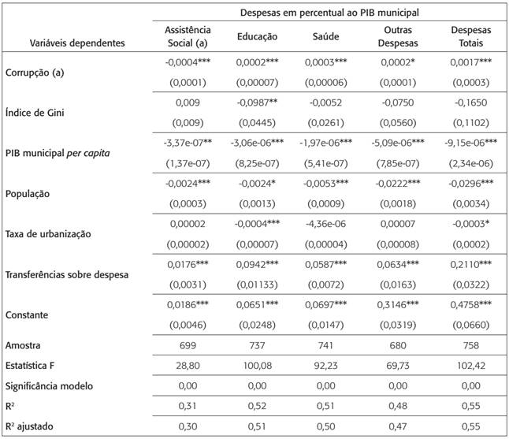
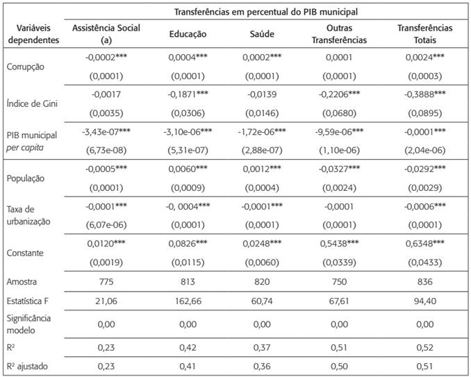

Rev. Adm. Pública 50 (2) - Mar-Apr 2016 

------------------------------------------------------------------------

## Introdução

- A corrupção representa um problema relevante para a gestão dos recursos públicos e pode afetar a eficiência da atuação governamental.

- A literatura econômica relaciona a corrupção a diferentes resultados, como menor crescimento econômico, redução dos investimentos e alterações na arrecadação e na aplicação dos recursos públicos.

- No caso dos municípios brasileiros, a alocação dos recursos ocorre dentro de um ambiente institucional específico, marcado por regras constitucionais e legais que estabelecem limites e vinculações para determinadas despesas.

- Essas restrições são particularmente importantes nas áreas de saúde e educação.

- Apesar dessas restrições, os gestores municipais possuem diferentes possibilidades de alocação dos recursos entre funções e categorias de despesas.

- Diante disso, torna-se relevante investigar se a corrupção está associada à forma como os municípios brasileiros distribuem seus gastos públicos.

--------------------------------------------------------------------------

## Objetivo e questão de pesquisa

**Objetivo:**

  - Investigar a relação entre corrupção e composição dos gastos públicos dos municípios brasileiros.

**Questão de pesquisa:**

  - A corrupção está relacionada à forma como os municípios brasileiros alocam seus gastos públicos?

Para responder à questão, os autores utilizam informações sobre irregularidades identificadas pela CGU e dados sobre as despesas municipais, analisando a relação entre corrupção e diferentes categorias de gastos públicos.

---------------------------------------------------------------------------

## Características relevantes do ambiente institucional brasileiro

**Despesas municipais e transferências da União**

- A legislação brasileira organiza as despesas municipais por diferentes funções de governo.

- Saúde e educação possuem participação elevada na composição das despesas municipais.

- Em 2010, essas duas funções representavam aproximadamente 48% das despesas municipais.

- As transferências da União possuem participação significativa no financiamento dessas áreas, evidenciando a dependência dos municípios em relação às transferências intergovernamentais.

**Limites obrigatórios de gastos públicos municipais**

- Os municípios estão sujeitos a regras que limitam sua discricionariedade na alocação dos recursos.

- Educação: aplicação mínima de 25% das receitas de impostos e transferências.

- Saúde: aplicação mínima de 15% das receitas de impostos e transferências.

- A Lei de Responsabilidade Fiscal estabelece limite de 60% da receita para despesas com pessoal.

- Apesar das vinculações, permanece espaço para decisões sobre como os recursos serão utilizados dentro de cada função.

------------------------------------------------------------------------------

## Características relevantes do ambiente institucional brasileiro

**Programa de Fiscalização por Sorteios Públicos da CGU**

- Criado em 2003, o programa tem como objetivo fiscalizar a aplicação de recursos públicos federais e combater irregularidades na administração pública.

- Os municípios são selecionados por meio de sorteios públicos, buscando reduzir a possibilidade de seleção direcionada das unidades fiscalizadas.

- As equipes da CGU realizam auditorias e analisam documentos, processos, recursos financeiros, obras e serviços públicos.

- As fiscalizações produzem relatórios com as irregularidades identificadas e respectivas evidências.

- Os dados da CGU permitem construir uma medida de corrupção baseada em irregularidades efetivamente constatadas, em vez de índices de percepção.

-------------------------------------------------------------------------------

## Estudos anteriores

- Mauro (1998): corrupção → menor gasto em Educação e Saúde.

- Gupta et al. (2001): corrupção → maior gasto militar.

- Estudos brasileiros relacionam corrupção a:

  - incentivos e discricionariedade dos gestores;
  - transferências públicas;
  - piora dos resultados educacionais;
  - redução da atividade empresarial.

- Lacuna: ausência de análise sobre corrupção e composição das despesas municipais.

------------------------------------------------------------------------------

##  Referencial teórico e desenvolvimento de hipóteses

**Quadro teórico**

- A corrupção é favorecida pela combinação de poder discricionário, oportunidade de extração de renda e instituições frágeis.
- Pela teoria de Rent-Seeking, agentes privados competem por benefícios e tratamento preferencial na utilização dos recursos públicos.
- O modelo considera que políticos e burocratas podem ser agentes da corrupção.

**Argumento central**

- A obrigatoriedade de gastos pode tornar Saúde e Educação setores mais atrativos para práticas de Rent-Seeking.

-----------------------------------------------------------------------------

## Desenvolvimento das hipóteses

**Educação e Saúde**

- H1: corrupção em educação → aumento das despesas municipais em educação.
- H2: corrupção em saúde → aumento das despesas municipais em saúde.
- H3: corrupção em educação → aumento das despesas de educação financiadas por transferências da União.
- H4: corrupção em saúde → aumento das despesas de saúde financiadas por transferências da União.

**Assistência Social**

- H5: corrupção em assistência social → redução das despesas municipais em assistência social.
- H6: corrupção em assistência social → redução das despesas de assistência social financiadas por transferências da União.

**Relação esperada**

- H1–H4: relação esperada positiva para Educação e Saúde.
- H5–H6: relação esperada negativa para Assistência Social.

-------------------------------------------------------------------------------

## Dados: fontes e construção

**A base foi construída a partir de quatro fontes principais:**

- CGU: auditorias do Programa de Fiscalização por Sorteios Públicos (PFSP).
- Portal da Transparência: transferências da União aos municípios.
- STN/Finbra: despesas orçamentárias municipais por função de governo.
- IBGE/IPEA: indicadores socioeconômicos e demográficos.

**Medida de corrupção**

- Aplicação de Text Mining às constatações da CGU.
- Tokenização e stemming para identificar termos associados a fraudes.
- Exemplos: notas frias, empresas fantasmas, superfaturamento e licitações simuladas.

-------------------------------------------------------------------------------

## Unidade de observação

- Unidade de análise: município brasileiro em determinado ano $(i,t)$.
- O ano $t$ corresponde ao período em que o município foi sorteado e fiscalizado pela CGU.

**Defasagem temporal**

- As irregularidades identificadas refletem práticas ocorridas antes da auditoria.
- Por isso, despesas, transferências e PIB consideram:
  - ano da fiscalização $(t)$;
  - ano anterior $(t-1)$.

A estrutura busca compatibilizar o período das irregularidades com os dados fiscais e econômicos.

-------------------------------------------------------------------------------

## Período e amostra

**Período**

- 20º ao 33º sorteio do PFSP.
- 2006–2010, com dados fiscais de 2005–2010.

**Amostra**

- 840 municípios.
- Municípios com até 500 mil habitantes.
- Capitais estaduais excluídas.
- 39 municípios foram sorteados mais de uma vez.

**Tratamento dos dados**

- Exclusão do Bolsa Família.
- Exclusão de falhas formais ou informativas.
- Exclusão de registros com inconsistências ou omissões contábeis.

---------------------------------------------------------------------------

## Variáveis dependentes

Foram estimados dois grupos de modelos:

**Modelo 1 — Despesas municipais**

$$
Y_{it}=\frac{\text{Despesa municipal}_{it}}{\text{PIB}_{it}}
$$

- Despesa total ou por função:
  - Educação;
  - Saúde;
  - Assistência Social

**Modelo 2 — Transferências da União**

$$
Y_{it}=\frac{\text{Transferências federais}_{it}}{\text{PIB}_{it}}
$$

- Valores em termos reais, deflacionados pelo IPCA.

------------------------------------------------------------------------------

## Variáveis explicativas e controles

**Variável de interesse**

$$
corrup_{it}=
\frac{\text{Constatações classificadas como corrupção}}
{\text{Total de constatações}}
$$

- Medida por município e função de governo.

**Variáveis de controle**

- Gini: desigualdade de renda.
- PIB per capita: nível de desenvolvimento econômico.
- População: tamanho do município.
- Urbanização: proporção da população urbana.
- Transferências/Despesa: participação dos repasses federais no orçamento.

-------------------------------------------------------------------------------

## Modelo econométrico

**Método**

- Mínimos Quadrados Ordinários (MQO).
  - "Nesse caso, o método de mínimos quadrados ordinários é adequado, na medida em que os municípios são sorteados aleatoriamente e com reposição ao longo dos anos, conferindo independência entre as observações e eliminando correlações entre erros ao longo dos anos" (Wooldridge, 2010)
- Erros-padrão robustos à heterocedasticidade e autocorrelação.
- Estrutura de Pooled Cross-Sections.

**Despesas municipais**

$$
Desppib_{it}=
\beta_0+\beta_1corrup_{it}
+\beta_2Gini_{it}
+\beta_3PIB_{it}
+\beta_4pop_{it}
+\beta_5urban_{it}
+\beta_6transf\_despesa_{it}
+\varepsilon_{it}
$$

**Transferências da União**

$$
Transfpib_{it}=
\beta_0+\beta_1corrup_{it}
+\beta_2Gini_{it}
+\beta_3PIB_{it}
+\beta_4pop_{it}
+\beta_5urban_{it}
+\varepsilon_{it}
$$

O coeficiente central é $\beta_1$: relação entre corrupção e alocação dos recursos públicos.

--------------------------------------------------------------------------------

## Diagnóstico descritivo

- Transferências da União representam, em média, 60% das despesas municipais.
- 15,65% das Ordens de Serviço apresentam constatações classificadas como corrupção.
- Maior incidência:
  - Saúde: 18,94%;
  - Educação: 17,54%.
- Menor incidência:
  - Assistência Social: 1,25%.

A corrupção concentra-se principalmente em Saúde e Educação.

-------------------------------------------------------------------------------

## Corrupção e despesas municipais

:::: columns

::: {.column width="50%"}
{width="100%"}

\centering{Fonte: Elaborado pelos autores}
:::

::: {.column width="50%"}
- Despesa Total/PIB: $\beta=0,0017$ ($p<0,01$).
- Educação/PIB: $\beta=0,0002$ ($p<0,01$).
- Saúde/PIB: $\beta=0,0003$ ($p<0,01$).
- Assistência Social: associação negativa.

Resultados:

- H1 e H2 confirmadas.
- H5 confirmada.
- Maior corrupção está associada à expansão das despesas totais, Educação e Saúde.

No Brasil, a corrupção parece expandir o orçamento, em vez de apenas redistribuí-lo entre funções.
:::

::::

-------------------------------------------------------------------------------

## Corrupção e transferências da União

:::: columns

::: {.column width="50%"}
{width="100%"}

\centering{Fonte: Elaborado pelos autores}
:::

::: {.column width="50%"}
- Transferências Totais/PIB: $\beta=0,0024$ ($p<0,01$).
- Educação/PIB: $\beta=0,0004$ ($p<0,01$).
- Saúde/PIB: $\beta=0,0002$ ($p<0,01$).
- Assistência Social/PIB: $\beta=-0,0002$ ($p<0,01$).

Resultados:

- H3 e H4 confirmadas.
- H6 confirmada.
- Corrupção associa-se a maiores transferências para Saúde e Educação.

Os repasses federais ampliam os recursos disponíveis nessas funções.
:::

::::

------------------------------------------------------------------------------

## Testes de robustez e mecanismo

**Testes de robustez**

- Exclusão dos 39 municípios sorteados mais de uma vez:
  - resultados permanecem significativos.
- Normalização pela despesa total:
  - Educação e Assistência mantêm os resultados;
  - Saúde perde significância.

**Mecanismo**

- A corrupção não parece simplesmente deslocar recursos entre funções.
- Municípios mais corruptos apresentam maior despesa total em relação ao PIB.
- Parte dessa expansão é direcionada para Saúde e Educação.

Corrupção associada à expansão do orçamento, e não apenas à sua redistribuição.

--------------------------------------------------------------------------------

## Conclusão

- Corrupção implica em maiores despesas e transferências em Saúde e Educação, divergindo da literatura internacional.
- Regras fiscais brasileiras direcionam recursos para setores com maior volume de recursos vinculados.
- A corrupção expande o orçamento municipal, sem evidência de melhoria proporcional dos serviços públicos.
- Novas fontes de recursos, como emendas e royalties, podem ampliar a exposição a desvios.
- Recomenda-se fortalecer:
  - transparência;
  - integridade;
  - controle interno;
  - mecanismos de fiscalização.

O ambiente institucional condiciona a relação entre corrupção e alocação dos gastos públicos.

--------------------------------------------------------------------------------

## Análise Crítica Econométrica

*O modelo utilizado é coerente com o problema investigado e com os dados?*

- Sim. O uso de MQO é compatível com o desenho da pesquisa.
- A normalização das despesas e transferências pelo PIB controla diferenças de escala entre municípios.

*Os coeficientes e demais resultados são interpretados adequadamente?*

- Sim. Os autores consideram sinal, significância estatística e contexto institucional.
- O teste de robustez mostra que os resultados são sensíveis à forma de normalização.

*Quais conclusões são efetivamente sustentadas pelos resultados?*

- Corrupção está associada a maiores despesas e transferências em Saúde e Educação.
- Há associação negativa com Assistência Social.
- Os resultados indicam associação, não necessariamente causalidade.

--------------------------------------------------------------------------------

## Análise Crítica Econométrica

*Algum pressuposto, característica dos dados ou problema econométrico merece atenção?*

- Possível endogeneidade por variáveis omitidas.
- A medida de corrupção baseada em Text Mining pode apresentar erro de mensuração.
- Os erros-padrão robustos são um ponto positivo.

*Existem limitações importantes para a interpretação dos resultados?*

- Validade externa restrita a municípios de até 500 mil habitantes.
- A variável representa corrupção detectada, não a corrupção total existente.
- Os resultados são sensíveis ao denominador utilizado nas variáveis dependentes.

